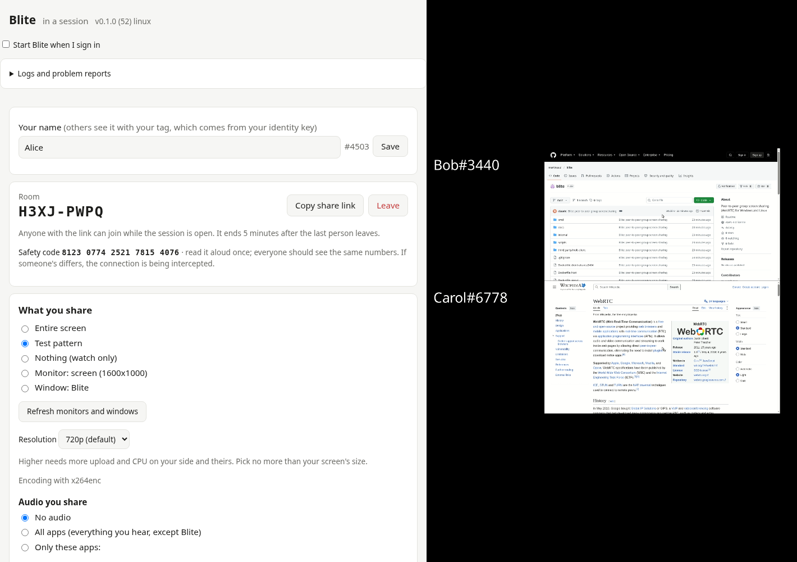

# Blite

Peer-to-peer group screen sharing for Windows and Linux. Everyone in a room
can share a screen, a window and app audio at the same time; the server only
introduces peers and never carries media.



More screenshots: [start screen](docs/screenshots/start.png),
[people and relay controls](docs/screenshots/people.png).

## Features

**Rooms**
- Start a session and send the link, or join one by link: rooms are a code
  plus a password, and `blite://` links open the app directly.
- Up to 5 participants per room. A hosted relay (below) takes one of the 5 seats.
- Each person has an identity key; names show with a 4-digit tag derived
  from it, so two people can't pass as each other.
- A safety code everyone can read aloud to confirm nobody is intercepting
  the connection.
- The room owner can hand ownership to someone else, disconnect people or
  ban them.

**Sharing**
- Share an entire screen, one monitor or one window, at 720p, 1080p or 4K.
  Blite steps the resolution down when the encoder can't keep up.
- Share audio from all apps or only selected ones (PipeWire on Linux,
  per-process loopback on Windows); Blite never echoes the call back.
- Hardware H.264 encoding when available (NVENC, Quick Sync, AMF, VA-API,
  Media Foundation), x264 otherwise.

**Watching**
- One window per person, or all screens in one grid window (automatic or
  your own rows and columns).
- Per-person video quality and volume, and a choice of playback device.
- Adapts to each viewer: every sharer sends a high and a low layer, plus
  in-between sizes (1080p, 720p) on request for viewers whose link or
  decoder can't take the top size; in relay mode the relay can transcode
  those. Lost packets are concealed by holding the last good picture until a
  keyframe arrives.

**Topologies**
- Full mesh by default: everyone sends directly to everyone.
- Relay mode: a member with a fast upload volunteers, and the others send
  their video only to them. Volunteers queue up; if the relay leaves, the
  next one takes over without dropping the call, or the room goes back to
  full mesh.
- Hosted relay: `blite -host rooms.json` runs headless on a server, keeps
  fixed rooms open around the clock and relays them.
- STUN by default; TURN (coturn) for peers behind strict NAT.

**App**
- Tray app with a local web UI; optional start at sign-in.
- Logs panel, and optional log reports to your server.
- On Windows, a crash guard runs Blite and keeps crash dumps.
- Optional signed self-update with automatic rollback.

**Platforms:** Windows, and Linux on X11 (Wayland sessions aren't supported
yet). The server runs anywhere Go does.

## Layout

- `cmd/blite`: the desktop app (tray, local web UI, GStreamer + Pion media).
- `cmd/blite-signal`: the signaling server (Go, no cgo).
- `cmd/blite-guard`: the Windows crash guard.
- `docs/PROTOCOL.md`: signaling wire protocol.
- `docs/SELF_HOSTING.md`: running your own server (TURN, hosted relay, client builds).

## Build and test

```bash
go test -race ./...
go build -o bin/blite-signal ./cmd/blite-signal
BLITE_ADDR=:8080 ./bin/blite-signal
go build -o bin/blite ./cmd/blite   # needs GStreamer 1.20+ development files
./bin/blite -server ws://localhost:8080/ws
```

Release packages: `scripts/build-deb.sh` (Ubuntu 24.04 / Mint 22, in Docker)
and `scripts/build-windows.sh` (cross-built with MinGW GStreamer). Server
image: `docker build -f Dockerfile.signal -t blite-signal .`

## License

Copyright (C) 2026 Martin Saul

Blite is free software: you can redistribute it and/or modify it under the
terms of the GNU Affero General Public License as published by the Free
Software Foundation, either version 3 of the License, or (at your option) any
later version. See [LICENSE](LICENSE).

The Windows release bundles GStreamer and its dependencies (LGPL and other
licenses), which keep their own terms.
