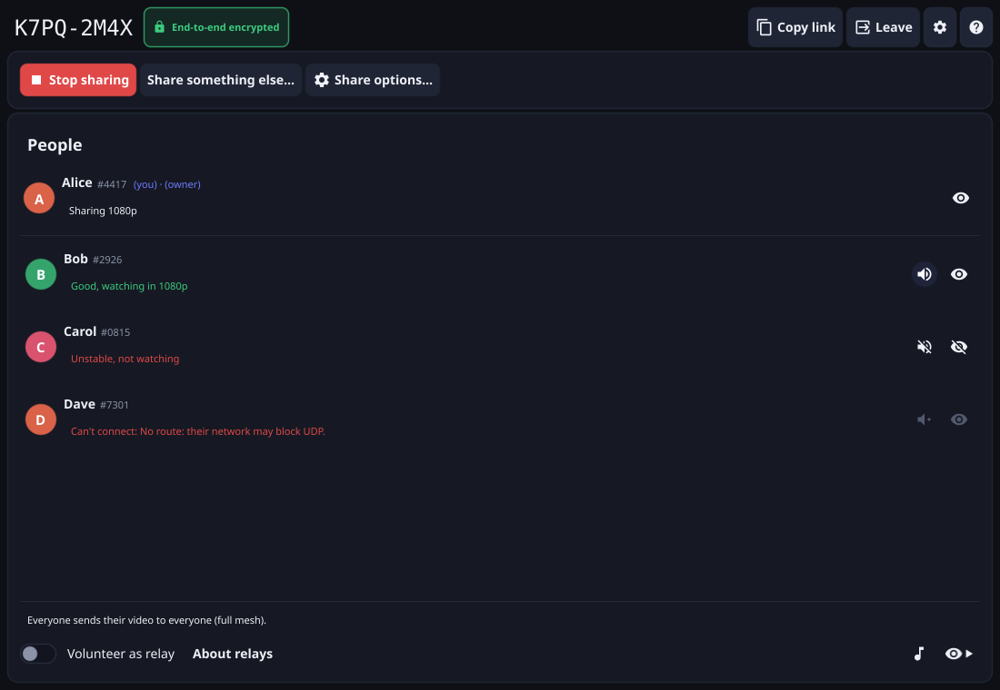
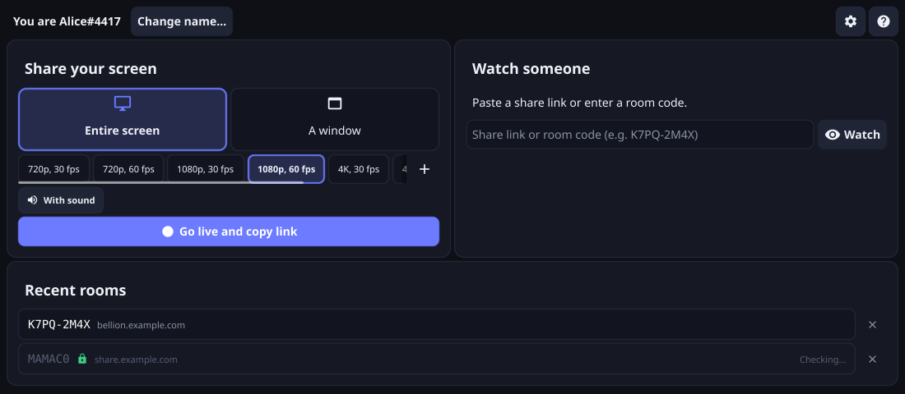
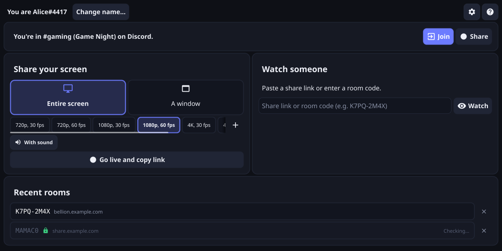

# Bellion Share

Peer-to-peer group screen sharing for Windows and Linux. Everyone in a call
can share a monitor, a window or all their screens, with app audio, at the
same time. The server only introduces people to each other and never carries
media.

**Download:** [bellion.app](https://bellion.app) ·
**Docs:** [bellion.app/docs](https://bellion.app/docs)

Formerly Blite. The code, binaries and packages still use the `blite` name.

> **Vibecoded, open and free.** Bellion Share is a vibecoded application: it
> was built with AI coding agents. It is fully open source and free: you pay
> nothing to run it. You are not only allowed but encouraged to review this
> code base yourself, or to have AI agents review it for you.



| Before a call | With Discord connected |
|---|---|
|  |  |

More screenshots: [Share options](docs/screenshots/share-options.png),
[a person's panel](docs/screenshots/person-panel.png),
[watching someone in your Discord voice channel](docs/screenshots/discord-watch.png).

## Bigger groups: relays

By default everyone sends their video straight to everyone, so each sharer
uploads their screen once per viewer. That's fine for a handful of people;
**with more than about 5, set up a relay**: a member with a fast upload
forwards everyone's video, so each sharer uploads once. Three ways, from
easiest:

1. **Volunteer from the app:** switch on *Volunteer as relay* at the bottom of
   the People list, on a PC with a fast, wired upload that isn't busy gaming.
2. **A dedicated relay machine for your group:** a spare PC, home server or
   VPS joins your room by its share link and relays, on any server including
   bellion.app:
   `blite -headless -link 'https://bellion.app/j/CODE#password' -volunteer -source none -view none -name "Group relay" -relay-upload-kbps 50000`
3. **A hosted relay on your own server:** `blite -host rooms.json` keeps
   fixed rooms open around the clock (needs your own signaling server; see
   [docs/SELF_HOSTING.md](docs/SELF_HOSTING.md#3-hosted-relay-optional)).

The full guide, with upload sizing, a systemd unit and troubleshooting:
[bellion.app/docs/relays](https://bellion.app/docs/relays) (also in
[docs/RELAYS.md](docs/RELAYS.md)).

## Features

**Sharing**
- Pick **Entire screen** or **A window** (a list with app icons), then
  **Go live and copy link** starts a session, shares it and copies the share
  link. No account needed.
- Switch what you share at any time in the call; *Share options > Advanced*
  also has all screens combined, a test pattern, or nothing (watch only).
- Quality presets: 720p, 1080p or 4K at 30 fps (sharp text) or 60 fps
  (smooth motion), plus your own (**+** adds one, **x** removes it).
  Bellion Share steps the resolution down when the encoder can't keep up.
- Sharing a window shares that app's audio automatically (if the app can't
  be found, there's no window audio and a note says so); the entire screen
  starts without sound. Or share the whole system's audio (never the call
  itself, so nothing echoes back) or only the apps you pick. PipeWire on
  Linux, per-app loopback capture on Windows. Whole-system audio leaves out
  voice chat apps (Discord, TeamSpeak...) unless you tick *Include voice apps*.
- Hardware H.264 encoding when available (NVENC, Quick Sync, AMF, VA-API,
  Media Foundation), x264 otherwise.
- A preview of your own stream in the video window, hidden with one click.

**Watching**
- Everyone you watch in one video window: pin a tile, or pop it out into
  its own window. An eye next to each person starts or stops watching them;
  new streams start watching automatically (the eye-and-play button at the
  bottom right turns that off).
- A speaker next to each person glows while they talk; click it to mute them
  for you (struck through), or see that they send no audio.
- When someone stops sharing, their tile says so and fades out.
- Click someone for their panel: volume (up to 200%), mute, video quality
  (Best or Low), connection details and owner actions. Plus a choice of
  playback device.
- Short sounds when someone joins, starts sharing or starts watching you, and
  when you go live (the music note at the bottom right turns them off).
- Adapts to each viewer: every sharer sends a high and a low layer, plus
  in-between sizes (1080p, 720p) for viewers whose connection or computer
  can't take the top size. Lost packets are concealed by holding the last
  good picture until the next keyframe.

**Discord**
- Connect Discord once, and Bellion Share follows the voice channel you're
  in: **Share** starts a session tied to it (**Join** enters it without
  sharing), and people in the channel see who's sharing and a **Watch**
  button. It only reads which voice channel you're in.
  See [Discord integration](https://bellion.app/docs/discord).
- **Not open to everyone yet:** Discord is still reviewing the Bellion app.
  Until then, Connect Discord only works for people added as testers, and
  there are only a few tester slots for now.

**Rooms and security**
- Sessions are a room code plus an optional password, shared as one link;
  links open the app directly (`bshare://`, and older `blite://` links).
  Typing just the room code works too, and the home screen lists your recent
  rooms for one-click rejoining.
- End-to-end encryption, on by default: each sender encrypts its media with
  keys only room members get, so a TURN server or relay passing it on can't
  read it.
- Each person has an identity key; names show with a 4-digit tag derived from
  it (like Alice#4417), and Bellion Share refuses to connect to someone whose
  encryption keys don't match their identity. A safety code everyone can read
  aloud confirms nobody is intercepting the call.
- The room owner can hand ownership to someone else, disconnect people or
  ban them.
- The password stays out of the join page and HTTP logs (it's in the link's
  `#` part), but the app sends it to the server over WSS to check it; the
  server keeps only an Argon2id hash, for as long as the session is open.
  So that restarts don't end calls, bellion.app saves open sessions to its
  disk (room code, password hash, members' names, identity keys and resume
  token hashes; no IP addresses), and drops each one within about 30 seconds
  after the session ends; self-hosted servers do this with
  `BLITE_STATE_FILE`. The password isn't part of
  the encryption keys, so a compromised server could add someone to your
  session: they would show in the People list and change the safety code.
  Relays get the room's keys, like any member.

**Relays**
- Full mesh by default: everyone sends directly to everyone. Above about 5
  people that strains most home uploads, and Bellion Share warns about it.
- Members with a fast upload volunteer as relays: the server picks as many as
  the room needs (up to 4), homes everyone on one, and any stream crosses at
  most two. Relays pull only what someone watches; when one leaves, its
  members move to another without dropping the call.
- A spare PC or server can relay for your group around the clock
  (`blite -headless -link ... -volunteer`), on any server; a hosted relay
  (`blite -host rooms.json`) keeps fixed rooms open on your own server. See
  [Bigger groups: relays](#bigger-groups-relays).

**The app**
- A native window plus a tray icon; optional start at sign-in. Buttons
  explain themselves on hover.
- Signed self-update with automatic rollback; updating during a call
  restarts the app and rejoins the call.
- Opens UDP port 30471 on your router (UPnP, NAT-PMP or PCP) by default, when
  allowed (`-udp-port 0` turns that off); STUN by default, TURN for peers
  behind strict NAT. As in any peer-to-peer app, people in a session learn
  each other's IP addresses.
- Send feedback and logs from the **?** menu. Room passwords are redacted
  from the log before it's written and from everything the app uploads. On
  Windows, a crash guard runs Bellion Share and keeps small crash dumps
  locally (never uploaded; no full memory, at most two, for up to 14 days).
- Release binaries on bellion.app are built privately, without public CI
  attestations; for full certainty, build from this repository.

**Platforms:** Windows 10 and 11 (64-bit), and Linux on X11 (Ubuntu 24.04,
Mint 22 or newer for the .deb; Wayland sessions aren't supported yet). The
signaling server runs anywhere Go does.

**Languages:** the app follows the system language: English, Chinese
(Simplified and Traditional), Hindi, Spanish, French, Bengali, Portuguese,
Russian, Indonesian, German, Japanese, Korean, Turkish, Vietnamese, Italian,
Polish, Ukrainian, Thai, Dutch, Tamil, Telugu, Marathi, Filipino and Swahili.
Arabic, Urdu and Persian are a preview you can pick in the gear menu's Language
(right-to-left layout isn't there yet). Translations were made by AI;
corrections are welcome.

## Quick start

1. Install from [bellion.app](https://bellion.app). Windows: run
   `BellionShare-Setup.exe` (code-signed; while the signature is new, Windows
   may still warn: More info > Run anyway), or
   use the portable zip and run `blite-guard.exe`. Linux:
   `sudo apt install ./blite_*.deb`.
2. Pick **Entire screen** or **A window** and press **Go live and copy
   link**. The share link is copied to your clipboard; paste it to your
   friends.
3. They click the link (or paste it, or the room code, into **Watch
   someone**) and see your screen. Everyone can go live too.

Details: [Getting started](https://bellion.app/docs/getting-started),
[Features](https://bellion.app/docs/features),
[Troubleshooting](https://bellion.app/docs/troubleshooting).

## Layout

- `cmd/blite`: the desktop app (Fyne window, tray, GStreamer + Pion media).
- `cmd/blite-signal`: the signaling server and website (Go, no cgo).
- `cmd/blite-guard`: the Windows crash guard.
- `cmd/blite-uidemo`: the app window with made-up people, for screenshots.
- `docs/PROTOCOL.md`: the signaling wire protocol.
- `docs/SELF_HOSTING.md`: running your own server (TURN, hosted relay, client builds).

## Building from source

Needs Go 1.26. The app also needs cgo with the GStreamer 1.20+ development
files and the OpenGL/X11 headers Fyne uses; on Ubuntu 24.04:

```bash
sudo apt install gcc pkg-config \
  libgstreamer1.0-dev libgstreamer-plugins-base1.0-dev libgstreamer-plugins-bad1.0-dev \
  libgl1-mesa-dev libx11-dev libxcursor-dev libxrandr-dev libxinerama-dev libxi-dev \
  libxxf86vm-dev libwayland-dev libxkbcommon-dev
```

```bash
go test -race ./...
go build -o bin/blite-signal ./cmd/blite-signal
BLITE_ADDR=:8080 ./bin/blite-signal
go build -o bin/blite ./cmd/blite
./bin/blite -server ws://localhost:8080/ws
```

At runtime the app needs the GStreamer plugins (base, good, bad, ugly, libav;
see the `Depends` line in `scripts/build-deb.sh`).

Release packages:
- `scripts/build-deb.sh`: the Ubuntu 24.04 / Mint 22 `.deb`, built in Docker
  (`Dockerfile.client-ubuntu2404`).
- `scripts/build-windows.sh`: the Windows zip, cross-built with MinGW against
  the GStreamer MSVC SDK (see the script's header for setup).
- `docker build -f Dockerfile.signal -t blite-signal .`: the server image.
- `Dockerfile.host`: the hosted relay image.

`scripts/version.sh` explains the build-time settings (default server,
update server and signing keys).

## Self-hosting

A deployment is one small signaling server, optionally with a TURN server
and a hosted relay. See [docs/SELF_HOSTING.md](docs/SELF_HOSTING.md) and
[Self-hosting](https://bellion.app/docs/self-hosting).

## License

Copyright (C) 2026 Martin Saul

Bellion Share is free software: you can redistribute it and/or modify it under the
terms of the GNU Affero General Public License as published by the Free
Software Foundation, either version 3 of the License, or (at your option) any
later version. See [LICENSE](LICENSE).

The Windows release bundles GStreamer and its dependencies (LGPL and other
licenses), which keep their own terms.
