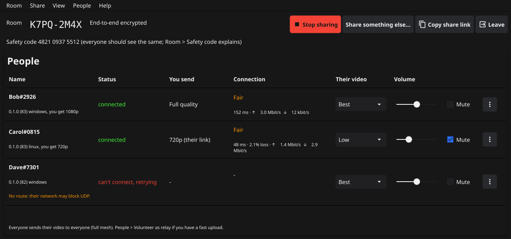
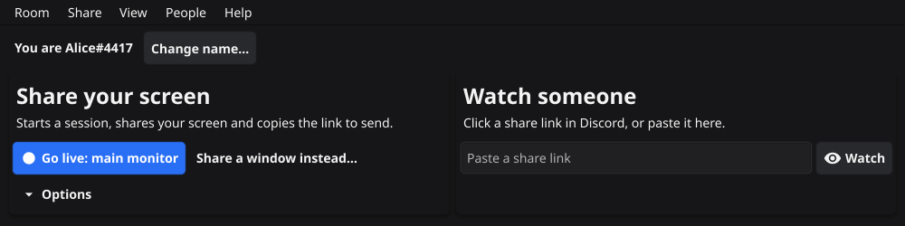
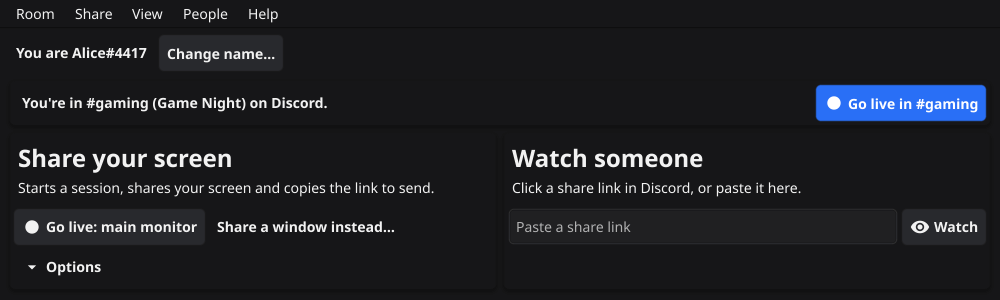

# Bellion Share

Peer-to-peer group screen sharing for Windows and Linux. Everyone in a call
can share a monitor, a window or all their screens, with app audio, at the
same time. The server only introduces people to each other and never carries
media.

**Download:** [bellion.app](https://bellion.app) ·
**Docs:** [bellion.app/docs](https://bellion.app/docs)

Formerly Blite. The code, binaries and packages still use the `blite` name.

> **Vibecoded, open and free.** Bellion Share is a vibecoded application: it
> was built with AI coding agents. It is fully open source and free: you pay
> nothing to run it. You are not only allowed but encouraged to review this
> code base yourself, or to have AI agents review it for you.



| Before a call | With Discord connected |
|---|---|
|  |  |

More screenshots: [the Share menu](docs/screenshots/share-menu.png),
[the People menu](docs/screenshots/people-menu.png),
[watching someone in your Discord voice channel](docs/screenshots/discord-watch.png).

## Bigger groups: relays

By default everyone sends their video straight to everyone, so each sharer
uploads their screen once per viewer. That's fine for a handful of people;
**with more than about 5, set up a relay**: a member with a fast upload
forwards everyone's video, so each sharer uploads once. Three ways, from
easiest:

1. **Volunteer from the app:** *People > Volunteer as relay* on a PC with a
   fast, wired upload that isn't busy gaming.
2. **A dedicated relay machine for your group:** a spare PC, home server or
   VPS joins your room by its share link and relays, on any server including
   bellion.app:
   `blite -headless -link 'https://bellion.app/j/CODE#password' -volunteer -source none -view none -name "Group relay" -relay-upload-kbps 50000`
3. **A hosted relay on your own server:** `blite -host rooms.json` keeps
   fixed rooms open around the clock (needs your own signaling server; see
   [docs/SELF_HOSTING.md](docs/SELF_HOSTING.md#3-hosted-relay-optional)).

The full guide, with upload sizing, a systemd unit and troubleshooting:
[bellion.app/docs/relays](https://bellion.app/docs/relays) (also in
[docs/RELAYS.md](docs/RELAYS.md)).

## Features

**Sharing**
- **Go live: main monitor** starts a session, shares your main monitor and
  copies the share link. No account needed.
- The Share menu switches what you share at any time: all screens combined,
  a single monitor, one window, a test pattern, or nothing (watch only).
- 720p, 1080p or 4K, tuned for desktop (sharp text, 30 fps) or games
  (smooth motion, 60 fps). Bellion Share steps the resolution down when the
  encoder can't keep up.
- Share audio from all apps (never the call itself, so nothing echoes back)
  or only the apps you pick; sharing a window shares that window's app audio
  automatically. PipeWire on Linux, per-app loopback capture on Windows.
- Hardware H.264 encoding when available (NVENC, Quick Sync, AMF, VA-API,
  Media Foundation), x264 otherwise.
- An optional preview of your own stream.

**Watching**
- One window per person, or everyone in one grid window (automatic or your
  own rows and columns). Closed a video window? **Show video** brings it back.
- When someone stops sharing, their tile says so and fades out.
- Per-person video quality (Best, Low, Off), volume and mute, and a choice of
  playback device.
- Adapts to each viewer: every sharer sends a high and a low layer, plus
  in-between sizes (1080p, 720p) for viewers whose connection or computer
  can't take the top size. Lost packets are concealed by holding the last
  good picture until the next keyframe.

**Discord**
- Connect Discord once, and Bellion Share follows the voice channel you're
  in: **Go live in #channel** starts a session tied to it, and people in the
  channel see a **Watch** button. It only reads which voice channel you're in.
  See [Discord integration](https://bellion.app/docs/discord).

**Rooms and security**
- Sessions are a room code plus an optional password, shared as one link;
  links open the app directly (`bshare://`, and older `blite://` links).
- End-to-end encryption, on by default: each sender encrypts its media with
  keys only room members get, so a TURN server or relay passing it on can't
  read it.
- Each person has an identity key; names show with a 4-digit tag derived from
  it (like Alice#4417), and Bellion Share refuses to connect to someone whose
  encryption keys don't match their identity. A safety code everyone can read
  aloud confirms nobody is intercepting the call.
- The room owner can hand ownership to someone else, disconnect people or
  ban them.

**Relays**
- Full mesh by default: everyone sends directly to everyone. Above about 5
  people that strains most home uploads, and Bellion Share warns about it.
- Members with a fast upload volunteer as relays: the server picks as many as
  the room needs (up to 4), homes everyone on one, and any stream crosses at
  most two. Relays pull only what someone watches; when one leaves, its
  members move to another without dropping the call.
- A spare PC or server can relay for your group around the clock
  (`blite -headless -link ... -volunteer`), on any server; a hosted relay
  (`blite -host rooms.json`) keeps fixed rooms open on your own server. See
  [Bigger groups: relays](#bigger-groups-relays).

**The app**
- A native window plus a tray icon; optional start at sign-in.
- Signed self-update with automatic rollback; updating during a call
  restarts the app and rejoins the call.
- Opens its UDP port on your router (UPnP, NAT-PMP or PCP) when allowed; STUN
  by default, TURN for peers behind strict NAT.
- Send feedback and logs from the Help menu. On Windows, a crash guard runs
  Bellion Share and keeps crash dumps.

**Platforms:** Windows 10 and 11 (64-bit), and Linux on X11 (Ubuntu 24.04,
Mint 22 or newer for the .deb; Wayland sessions aren't supported yet). The
signaling server runs anywhere Go does.

**Languages:** the app follows the system language: English, Chinese
(Simplified and Traditional), Hindi, Spanish, French, Bengali, Portuguese,
Russian, Indonesian, German, Japanese, Korean, Turkish, Vietnamese, Italian,
Polish, Ukrainian, Thai, Dutch, Tamil, Telugu, Marathi, Filipino and Swahili.
Arabic, Urdu and Persian are a preview you can pick in View > Language
(right-to-left layout isn't there yet). Translations were made by AI;
corrections are welcome.

## Quick start

1. Install from [bellion.app](https://bellion.app). Windows: unzip and run
   `blite-guard.exe` in the `blite` folder. Linux: `sudo apt install ./blite_*.deb`.
2. Press **Go live: main monitor**. The share link is copied to your
   clipboard; paste it to your friends.
3. They click the link (or paste it into **Watch someone**) and see your
   screen. Everyone can press Go live too.

Details: [Getting started](https://bellion.app/docs/getting-started),
[Features](https://bellion.app/docs/features),
[Troubleshooting](https://bellion.app/docs/troubleshooting).

## Layout

- `cmd/blite`: the desktop app (Fyne window, tray, GStreamer + Pion media).
- `cmd/blite-signal`: the signaling server and website (Go, no cgo).
- `cmd/blite-guard`: the Windows crash guard.
- `cmd/blite-uidemo`: the app window with made-up people, for screenshots.
- `docs/PROTOCOL.md`: the signaling wire protocol.
- `docs/SELF_HOSTING.md`: running your own server (TURN, hosted relay, client builds).

## Building from source

Needs Go 1.26. The app also needs cgo with the GStreamer 1.20+ development
files and the OpenGL/X11 headers Fyne uses; on Ubuntu 24.04:

```bash
sudo apt install gcc pkg-config \
  libgstreamer1.0-dev libgstreamer-plugins-base1.0-dev libgstreamer-plugins-bad1.0-dev \
  libgl1-mesa-dev libx11-dev libxcursor-dev libxrandr-dev libxinerama-dev libxi-dev \
  libxxf86vm-dev libwayland-dev libxkbcommon-dev
```

```bash
go test -race ./...
go build -o bin/blite-signal ./cmd/blite-signal
BLITE_ADDR=:8080 ./bin/blite-signal
go build -o bin/blite ./cmd/blite
./bin/blite -server ws://localhost:8080/ws
```

At runtime the app needs the GStreamer plugins (base, good, bad, ugly, libav;
see the `Depends` line in `scripts/build-deb.sh`).

Release packages:
- `scripts/build-deb.sh`: the Ubuntu 24.04 / Mint 22 `.deb`, built in Docker
  (`Dockerfile.client-ubuntu2404`).
- `scripts/build-windows.sh`: the Windows zip, cross-built with MinGW against
  the GStreamer MSVC SDK (see the script's header for setup).
- `docker build -f Dockerfile.signal -t blite-signal .`: the server image.
- `Dockerfile.host`: the hosted relay image.

`scripts/version.sh` explains the build-time settings (default server,
update server and signing keys).

## Self-hosting

A deployment is one small signaling server, optionally with a TURN server
and a hosted relay. See [docs/SELF_HOSTING.md](docs/SELF_HOSTING.md) and
[Self-hosting](https://bellion.app/docs/self-hosting).

## License

Copyright (C) 2026 Martin Saul

Bellion Share is free software: you can redistribute it and/or modify it under the
terms of the GNU Affero General Public License as published by the Free
Software Foundation, either version 3 of the License, or (at your option) any
later version. See [LICENSE](LICENSE).

The Windows release bundles GStreamer and its dependencies (LGPL and other
licenses), which keep their own terms.
